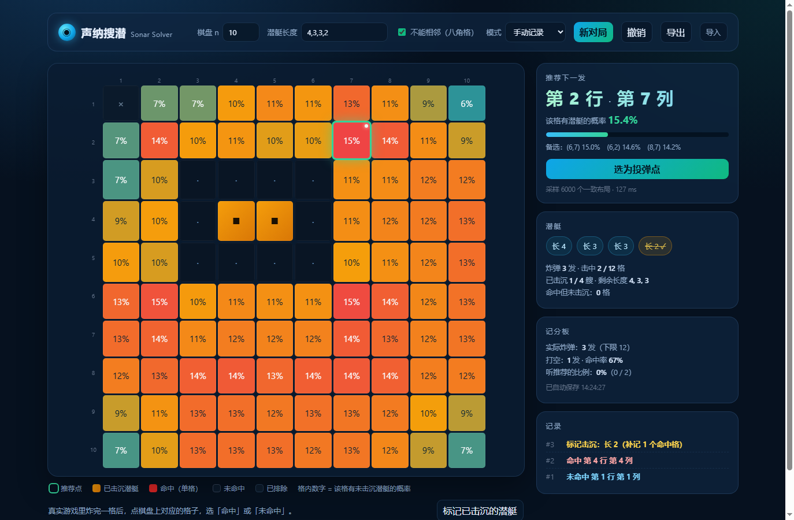

# 声纳搜潜 · 潜艇寻找器

一个带界面的“战舰 / 声纳”求解器：在 `n × n` 的海域里把潜艇全部炸沉，用尽量少的炸弹。


上图：10×10、潜艇长度 4,3,3,2。橙色 ■ 是已击沉的两艘（长 3、长 2），它们周围的 · 是“八角格已排除”，
剩下的热力图是每格“有未击沉潜艇”的概率，绿色闪烁框 = 推荐点。

## 规则（当前版本 v2）

- 棋盘 `n × n`；
- 潜艇长度是一个**数列**，可以多艘、长度不等，例如 `5,4,4,3,3,2`；
- 每艘潜艇长 `L`、宽 `1`，只能横放或竖放，互不重叠；
- 潜艇之间不能八邻接：一艘潜艇周围 8 格内不会再有其它的潜艇；
- **炸到潜艇只显示这一格命中**，不会暴露整艘；
- **一艘潜艇的所有格子都被炸中，它才算被击沉**（这时才会被抓出来）；
- 目标：用最少的炸弹把全部潜艇击沉。

## 版本

| 版本 | 规则 | 位置 |
| --- | --- | --- |
| **v2（当前）** | 命中只显示单格，整艘炸满才击沉 | 根目录 `index.html` |
| v1（存档） | 命中即显示整艘潜艇 | `versions/v1-hit-reveals-ship/index.html` |

两个版本各自独立（各有一份 `sonar_core.js` / `app.js` / `index.html`），互不影响：
v1 用 `legacy_shim.js` 把“命中即显示整艘”的表达方式映射到同一套概率核心上，
所以两版的概率算法一致，只是反馈规则不同。

## 快速开始

双击打开 `index.html`（纯静态页面，不需要服务器）。

顶部填 `n` 和长度数列（逗号分隔），选择模式，点「新对局」。

### 模式一：自动对局（直接在页面里玩）

- 点格子投弹；命中只亮这一格（●），整艘炸满才变橙色 ■，它的八邻格同步变成 ·（已排除）；
- 绿色闪烁框 = 推荐点，「就炸这里」直接打；
- 「自动演示」让求解器自己打完整局，「撤销」撤回上一发。

### 模式二：手动记录（配合真实游戏）

真实游戏里炸完一格后：点棋盘上对应的格子 → 选「命中」或「未命中」。
游戏宣布某艘被击沉时，点「标记已击沉的潜艇」，再点它的所有格子确认（缺的命中格会自动补记）。
求解器也会自动推断：当一组命中格在所有可能布局里都只能解释成“已炸满的一艘”，直接记为击沉。



上图：命中两格后的样子——两个 ● 是“命中但还没击沉”，它们旁边的格子概率跳到 50% 左右，
说明模型已经在沿这条线补枪。

### 存档 / 记分板

- 每一步自动存到浏览器本地，**关掉页面再打开会接着上次的进度**；
- 「导出」「导入」可以把对局存成 JSON 文件，换机器也能继续；
- 「记分板」显示：实际炸弹数、理论下限（潜艇总格数）、打空次数、命中率、
  听推荐的比例，以及**求解器在同一局面上从头打需要几发**（打完后给出差距）。

## 选点策略：这是贪心，但不是最优

做法是：维护“与当前所有反馈一致的布局”集合 → 在集合上取均匀分布 → 统计每格
**pOcc = 该格属于某艘未击沉潜艇的概率** → 每发炸当前 pOcc 最高的格子。

**是的，这是贪心**：只看“这一发命中概率最高”，不做多步搜索。理论上不保证全局最优，
但差距很小，而且在这个玩法下贪心特别划算：

- 命中一格是纯收益（那格早晚都得炸），打空是纯浪费 → 单步目标就是“少打空”；
- 命中一艘没炸完的潜艇后，邻格因为“潜艇连续”会自动获得更高 pOcc，于是补枪行为
  是从概率里自然长出来的，不需要额外写死规则。

### 贪心到底差多少？小棋盘上算过精确最优

`dp_optimal.js` 用动态规划枚举所有信息状态，直接算“最优策略的期望炸弹数”，
再和贪心比较（规则 v2，含不能八邻接）：

| 配置 | 精确最优 | 概率贪心 | 差距 |
| --- | ---: | ---: | ---: |
| 4×4，长度 2,2 | 6.111 发 | 6.167 发 | +0.9% |
| 4×4，长度 2,3 | 7.125 发 | 7.125 发 | 0（完全一致） |

（5×5 及以上的精确 DP 状态数太大 —— 5×5 / 长度 2,2 就超过 Map 的容量上限，所以只能在小棋盘上验证。）

### 多艘潜艇时（你问的 10×10、5,4,4,3,3,2）

面积 21 格、棋盘 100 格，30 局同批棋盘：

| 策略 | 10×10 | 12×12（同样 21 格） |
| --- | ---: | ---: |
| 求解器（align 策略） | **39.7 ± 1.7** | **50.9 ± 3.4** |
| 纯概率贪心 | 41.0 ± 1.5 | 53.8 ± 3.0 |
| 随机炸 | 95.2 ± 1.6 | 138.5 ± 2.6 |

所以：**找不到严格最优解**（状态空间指数级），但能稳定接近——比随机好一倍以上，
并且比“纯贪心”再多省 3%~6%（命中后优先沿已知命中线延长，参见下面的策略选项）。

### 概率是怎么算的

- 剩余潜艇少 / 候选总数小 → **精确枚举**一致布局（概率是精确值）；
- 只剩一艘 → 解析公式（在有效位置上均匀）；
- 一般情况 → **拒绝采样**：给每艘潜艇随机取位置，互不重叠、不八邻接、覆盖所有命中格才接受，
  每个合法布局被接受的概率相同，样本严格均匀；
- 采样太慢时用 MCMC 兜底。

## 分享材料

| 用途 | 文件 | 说明 |
| --- | --- | --- |
| 网页版讲解（简版） | `story.html` | 以「海岛奇兵 · 声纳活动」为引子：结论（95→40 发）→ 一句解释 → 截图 → 实测数据 → 一句实话 → 怎么用；不谈公式 |
| 短视频脚本 | `video_script.md` | 约 60 秒竖屏脚本（分镜 / 旁白 / 字幕 / 录制要点） |
| 发布到网上 | `DEPLOY.md` | GitHub + Vercel 的完整步骤（网页上传 / Git 命令行、域名、国内访问、更新流程） |

讲解主线：**引子**（声纳活动里大多数人凭手气炸）→ **反差**（同样一局 95 发 vs 40 发）→
**一句话解释**（炸药数 = 总格数 + 打空数，所以每发炸概率最高的格子；
潜艇连着一条，命中后补枪是概率自己冒出来的）→ **一句实话**（贪心非最优，小棋盘差不到 1%）。

## 发布到网上

纯静态（三个文件、无构建、无后端），推到 GitHub 后在 Vercel 里 Import 即可，几分钟拿到一个
`https://xxx.vercel.app` 的链接。完整步骤、要传哪些文件、换域名、以及「国内能不能打开」的注意事项
都在 `DEPLOY.md`。

## 验证

```bash
node test_core.js        # 概率 vs 独立暴力枚举、规则行为、完整对局模拟
node test_ui.js          # 浏览器交互测试（存档续玩、记分板、自动演示等）
node dp_optimal.js 4 2,2 # 精确最优 vs 贪心
node bench_config.js 10 5,4,4,3,3,2 30   # 指定配置的策略对比
node versions/v1-hit-reveals-ship/test_legacy.js  # 旧版行为验证
```

结果：

- 概率与独立穷举逐格一致：4 组参数 × 每题 25 个局面，`max|ΔpOcc| = 0.0000`；
- 单格命中不泄露整艘（剩余长度不变）；整艘炸满能自动推断击沉；
- 旧版（v1）验证通过：命中并显示整艘后，剩余长度立刻扣减、八邻格排除；
- 界面测试 19 项全绿：投弹、单格命中只亮一格、标记击沉、撤销、自动演示通关、
  刷新后恢复进度、记分板、导入导出入口、无报错。

## 文件

| 文件 | 作用 |
| --- | --- |
| `index.html` / `app.js` / `sonar_core.js` | 当前版本（v2）的界面、界面逻辑、求解核心 |
| `versions/v1-hit-reveals-ship/` | 旧版（命中即显示整艘），含独立核心与自身测试 |
| `test_core.js` | 概率正确性 + 规则行为 + 对局模拟 |
| `test_ui.js` | 界面交互测试（Chrome DevTools Protocol） |
| `dp_optimal.js` | 小棋盘精确最优策略（对比贪心） |
| `bench_config.js` / `bench_paired.js` | 指定配置 / 同批棋盘的策略对比 |
| `make_shots.js` | 生成 README 截图 |
| `check_wendydassy.py` | 检查 wendydassy 渠道模型是否可用 |
| `acl-recovery-backup/` | 一次性权限修复的备份与报告（可删） |
