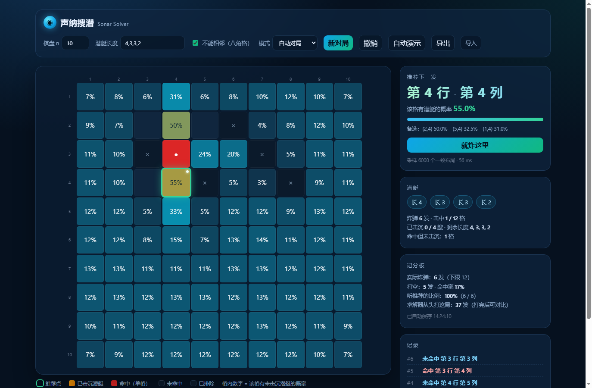

# 声纳搜潜 · 潜艇寻找器

一个带界面的“战舰 / 声纳”求解器：在 `n × n` 的海域里把潜艇全部炸沉，用尽量少的炸弹。

上图：10×10、潜艇长度 4,3,3,2。橙色 ■ 是已击沉的两艘（长 3、长 2），它们周围的 · 是“八角格已排除”，
剩下的热力图是每格“有未击沉潜艇”的概率，绿色闪烁框 = 推荐点。

## 规则（当前版本 v2）

- 棋盘 `n × n`；
- 潜艇长度是一个**数列**，可以多艘、长度不等，例如 `5,4,4,3,3,2`；
- 每艘潜艇长 `L`、宽 `1`，只能横放或竖放，互不重叠；
- 潜艇之间不能八邻接：一艘潜艇周围 8 格内不会再有其它的潜艇；
- **炸到潜艇只显示这一格命中**，不会暴露整艘；
- **一艘潜艇的所有格子都被炸中，它才算被击沉**（这时才会被抓出来）；
- 目标：用最少的炸弹把全部潜艇击沉。

## 快速开始

双击打开 `index.html`（纯静态页面，不需要服务器）。

顶部填 `n` 和长度数列（逗号分隔），选择模式，点「新对局」。

### 模式一：自动对局（直接在页面里玩）

- 点格子投弹；命中只亮这一格（●），整艘炸满才变橙色 ■，它的八邻格同步变成 ·（已排除）；
- 绿色闪烁框 = 推荐点，「就炸这里」直接打；
- 「自动演示」让求解器自己打完整局，「撤销」撤回上一发。

### 模式二：手动记录（配合真实游戏）

真实游戏里炸完一格后：点棋盘上对应的格子 → 选「命中」或「未命中」。
游戏宣布某艘被击沉时，点「标记已击沉的潜艇」，再点它的所有格子确认（缺的命中格会自动补记）。
求解器也会自动推断：当一组命中格在所有可能布局里都只能解释成“已炸满的一艘”，直接记为击沉。

上图：命中两格后的样子——两个 ● 是“命中但还没击沉”，它们旁边的格子概率跳到 50% 左右，
说明模型已经在沿这条线补枪。

### 存档 / 记分板

- 每一步自动存到浏览器本地，**关掉页面再打开会接着上次的进度**；
- 「导出」「导入」可以把对局存成 JSON 文件，换机器也能继续；
- 「记分板」显示：实际炸弹数、理论下限（潜艇总格数）、打空次数、命中率、
  听推荐的比例，以及**求解器在同一局面上从头打需要几发**（打完后给出差距）。

## 选点策略：这是贪心，但不是最优

做法是：维护“与当前所有反馈一致的布局”集合 → 在集合上取均匀分布 → 统计每格
**pOcc = 该格属于某艘未击沉潜艇的概率** → 每发炸当前 pOcc 最高的格子。

**是的，这是贪心**：只看“这一发命中概率最高”，不做多步搜索。理论上不保证全局最优，
但差距很小，而且在这个玩法下贪心特别划算：

- 命中一格是纯收益（那格早晚都得炸），打空是纯浪费 → 单步目标就是“少打空”；
- 命中一艘没炸完的潜艇后，邻格因为“潜艇连续”会自动获得更高 pOcc，于是补枪行为
  是从概率里自然长出来的，不需要额外写死规则。

### 贪心到底差多少？小棋盘上算过精确最优

`dp_optimal.js` 用动态规划枚举所有信息状态，直接算“最优策略的期望炸弹数”，
再和贪心比较（规则 v2，含不能八邻接）：

| 配置 | 精确最优 | 概率贪心 | 差距 |
| --- | ---: | ---: | ---: |
| 4×4，长度 2,2 | 6.111 发 | 6.167 发 | +0.9% |
| 4×4，长度 2,3 | 7.125 发 | 7.125 发 | 0（完全一致） |

（5×5 及以上的精确 DP 状态数太大 —— 5×5 / 长度 2,2 就超过 Map 的容量上限，所以只能在小棋盘上验证。）

### 多艘潜艇时（你问的 10×10、5,4,4,3,3,2）

面积 21 格、棋盘 100 格，30 局同批棋盘：

| 策略 | 10×10 | 12×12（同样 21 格） |
| --- | ---: | ---: |
| 求解器（align 策略） | **39.7 ± 1.7** | **50.9 ± 3.4** |
| 纯概率贪心 | 41.0 ± 1.5 | 53.8 ± 3.0 |
| 随机炸 | 95.2 ± 1.6 | 138.5 ± 2.6 |

所以：**找不到严格最优解**（状态空间指数级），但能稳定接近——比随机好一倍以上，
并且比“纯贪心”再多省 3%~6%（命中后优先沿已知命中线延长，参见下面的策略选项）。

### 概率是怎么算的

- 剩余潜艇少 / 候选总数小 → **精确枚举**一致布局（概率是精确值）；
- 只剩一艘 → 解析公式（在有效位置上均匀）；
- 一般情况 → **拒绝采样**：给每艘潜艇随机取位置，互不重叠、不八邻接、覆盖所有命中格才接受，
  每个合法布局被接受的概率相同，样本严格均匀；
- 采样太慢时用 MCMC 兜底。
